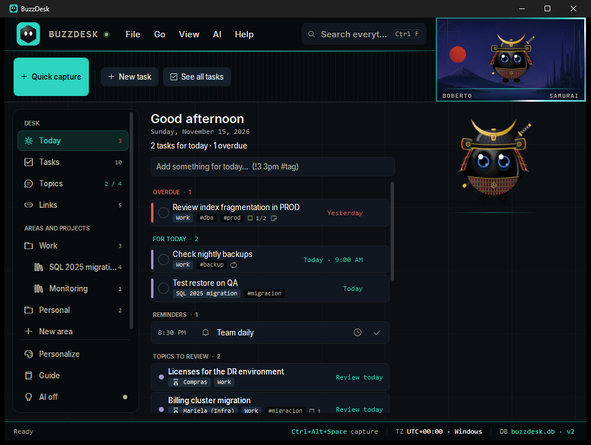
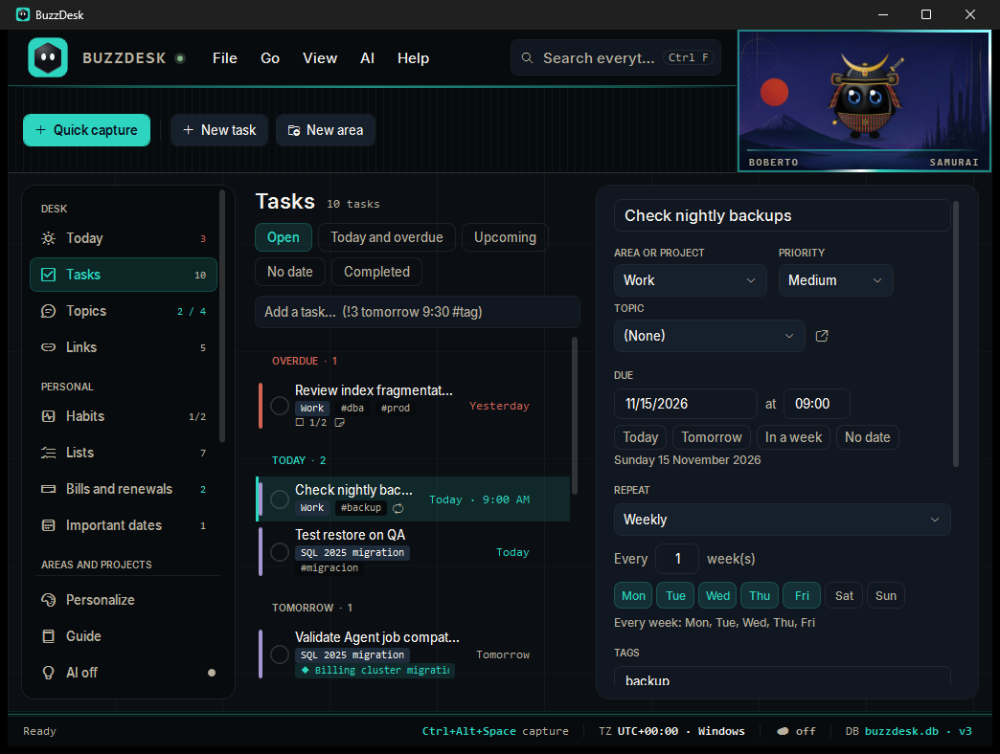
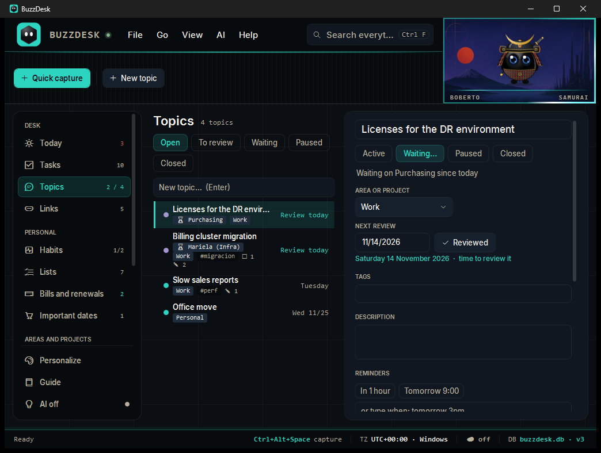
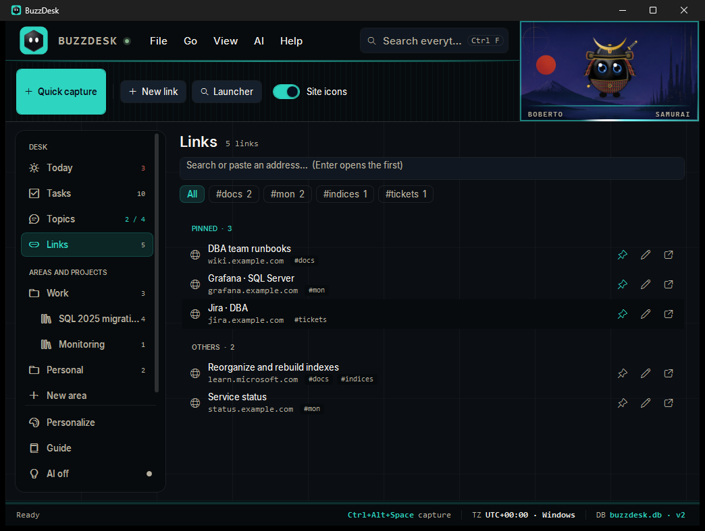
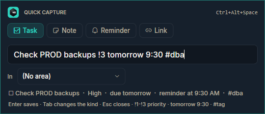

# BuzzDesk

**Work and personal organizer for Windows.** Today at a glance, tasks with recurrence and subtasks, Windows reminders with snooze, topic follow-up ("waiting on…", review dates, a timeline of notes), useful links with a quick launcher, a quick-capture card (`Ctrl+Alt+Space`) and search across everything (`Ctrl+F`). Everything lives in a local SQLite database with automatic daily backups. With Boberto, the live companion you can dress up, and a built-in guide (`F1`). Optional **AI**, off until you turn it on. English by default, Spanish built in. MIT licensed.

BuzzDesk is the sibling of [BuzzPrint](https://github.com/ChristianBuzzetti/BuzzPrint): same author, same look and feel.



| Tasks | Topics |
|---|---|
|  |  |
| **Links** | **Quick capture** |
|  |  |

**Requirements:** Windows 10/11 and Microsoft Edge WebView2 Runtime (included with Windows 11). To build: .NET 10 SDK.

## What it does

- **Today**: what's overdue and due today, today's reminders, topics whose review date has come, loose notes from quick capture, pinned links, and what's coming up. Boberto keeps you company.
- **Tasks**: priority, due date and time, subtasks, tags, areas (Work, Personal) and projects, recurrence (daily, weekly on chosen days, monthly on a day or the last day, **last business day of the month**). Completing a recurring task creates the next one with its subtasks, tags and reminders. Postpone counts how many times a task was pushed. Type `Check PROD backups !3 tomorrow 9:30 #dba` and it understands priority, day, time and tags.
- **Reminders**: native Windows notifications with *10 min*, *1 hour*, *Tomorrow* and *Done*, ringing from the tray even with the window closed. Missed ones show up when you're back.
- **Topics**: status (active, waiting, paused, closed), who you're waiting on and since when, next review date, a timeline of notes (status changes and reviews logged by themselves), its tasks and its links.
- **Links**: URL, title and icon (fetched from the site itself, can be turned off), tags, pinned links in Today, search as you type, and a launcher (`Ctrl+Alt+L` anywhere).
- **Quick capture** (`Ctrl+Alt+Space`): a small card next to the cursor for a task, note, reminder or link in two seconds.
- **Search** (`Ctrl+F`): one box over tasks, topics, notes and links; accents don't matter, word beginnings match.

## Download (no build needed)

1. Download **`BuzzDesk-<version>-win-x64.zip`** from the [latest release](https://github.com/ChristianBuzzetti/BuzzDesk/releases/latest) (or from the *build* workflow's artifacts).
2. Extract it anywhere, for example `C:\Apps`, and open `BuzzDesk\BuzzDesk.exe`.

Nothing else to install: .NET is included. If WebView2 (for Boberto) is missing, BuzzDesk offers to install it. The app isn't code-signed, so Windows SmartScreen may show *"Windows protected your PC"*: click **More info → Run anyway**.

## Build from source

```powershell
winget install Git.Git
winget install Microsoft.DotNet.SDK.10
git clone https://github.com/ChristianBuzzetti/BuzzDesk.git
cd BuzzDesk
powershell -ExecutionPolicy Bypass -File .\build.ps1          # dist\BuzzDesk\BuzzDesk.exe
powershell -ExecutionPolicy Bypass -File .\build.ps1 -Zip     # also artifacts\BuzzDesk-<version>-win-x64.zip
powershell -ExecutionPolicy Bypass -File .\build.ps1 -Shot    # also the screenshots in docs\ (demo database)
dotnet test tests\BuzzDesk.Tests                             # data and domain tests (any OS)
```

`dist\BuzzDesk` is the complete, portable app. Close BuzzDesk (tray icon → Exit) before rebuilding. `-Msix` builds the Microsoft Store package (identity in `packaging\store.json`).

## Data

| What | Where |
|---|---|
| Database | `%LOCALAPPDATA%\BuzzDesk\buzzdesk.db` |
| Backups | `%LOCALAPPDATA%\BuzzDesk\backups` |
| Settings, appearance, Boberto | `%LOCALAPPDATA%\BuzzDesk\*.json` |

For the DBA in the room:

- **SQLite** through Microsoft.Data.Sqlite, **WAL**, `PRAGMA application_id = 'BZDK'`; per connection `foreign_keys = ON`, `busy_timeout = 5000`, `synchronous = NORMAL`.
- **Versioned schema**: `src/BuzzDesk/Data/Migrations/NNNN_*.sql`, embedded, each applied in its own transaction and recorded in `schema_version` with a SHA-256 checksum (a changed script stops the app). `PRAGMA foreign_key_check` after each step; a backup is taken before migrating.
- **Normalized**: sections (areas/projects), tasks (self-referencing subtasks), recurrence rules, topics, people, notes, reminders, links, tags with one junction table per entity. **STRICT** tables, CHECK constraints on every status and format, every foreign key indexed, partial indexes for the hot screens (open tasks by due date, pending reminders, topics to review, live links).
- **Dates**: instants in UTC (`*_utc`, ISO-8601); calendar days (`due_date`, `next_review_date`) are dates in the user's time zone (Windows' own or the one chosen in *View → Time zone*).
- **Search**: one FTS5 table (`unicode61 remove_diacritics 2`, prefix indexes) kept current by triggers; `rowid = id * 8 + kind`.
- **Backups**: SQLite's online backup API, verified with `quick_check`; daily, keeping 14 daily + 8 weekly copies, plus *File → Back up now*. To restore: exit BuzzDesk and copy a backup over `buzzdesk.db`.
- Tests (`tests/BuzzDesk.Tests`) cover constraints, migrations (including a real v1 → v2 upgrade), recurrence, quick-capture parsing, reminders, search and backup retention, plus schema lint (STRICT everywhere, every FK indexed).

## Code shared with BuzzPrint

`src/BuzzDesk/Appearance/` (palettes, fonts, Personalize, live logo, Boberto Studio / Stage / Dock), `Assets/Boberto/`, `Assets/Fonts/`, `IconMaker`, `Core/Loc`, `Core/Dependencies`, the guide and prompt windows and the optional AI (`Core/Ai`, `AiSettingsWindow`) are **copied** from BuzzPrint for now. Later they move to a shared library, **Buzz.Appearance**, used by both apps. `tools/check-loc.py` checks that every Spanish UI string has its English translation.

## Roadmap (phase 2)

- Outlook / Google Calendar.
- Jira.
- Attach BuzzPrint captures to a topic.
- Daily and weekly summary with AI.
- Export a weekly report to Word / PDF with BuzzPrint's templates.
- Holidays for "last business day".

## Privacy

Everything stays on your PC. See [PRIVACY.md](PRIVACY.md).

## License

MIT (see `LICENSE`). Fonts and packages: see `THIRD-PARTY-NOTICES.md`.
