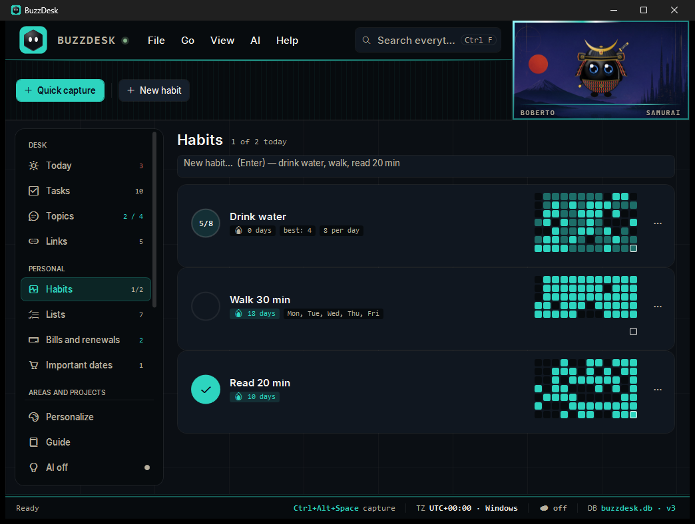
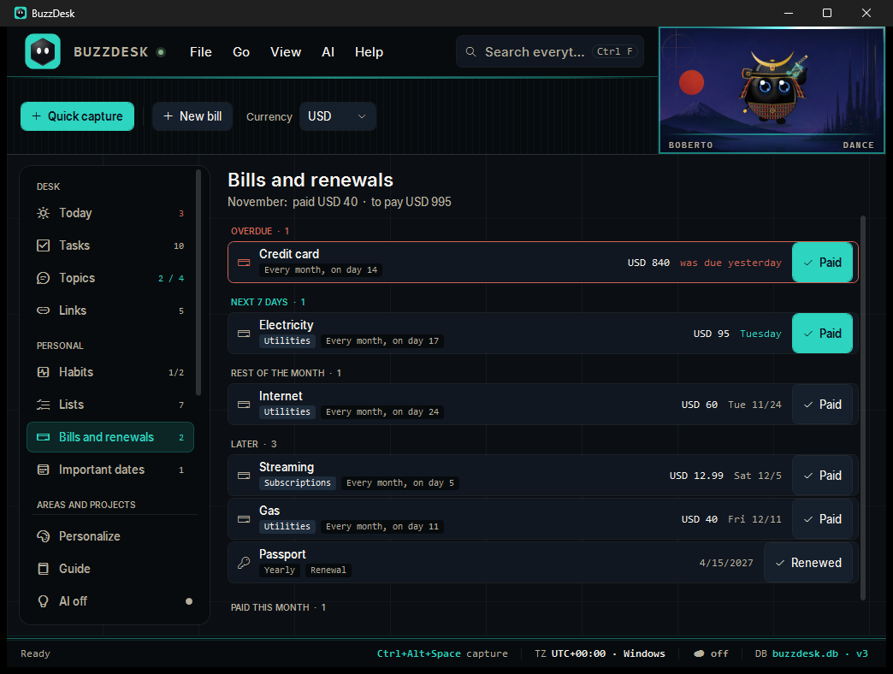

# BuzzDesk

**Work and personal organizer for Windows.** Today at a glance with your three priorities, tasks with recurrence and subtasks, Windows reminders with snooze, habits with streaks, reusable lists, bills and renewals, birthdays and important dates, topic follow-up ("waiting on…", review dates, a timeline of notes), useful links with a quick launcher, a quick-capture card (`Ctrl+Alt+Space`) and search across everything (`Ctrl+F`). Everything lives in a local SQLite database with automatic daily backups, and optionally an encrypted copy in your OneDrive, Google Drive or Dropbox. With Boberto, the live companion you can dress up, and a built-in guide (`F1`). Optional **AI**, off until you turn it on. English by default, Spanish built in. MIT licensed.

BuzzDesk is the sibling of [BuzzPrint](https://github.com/ChristianBuzzetti/BuzzPrint): same author, same look and feel.


| Tasks | Topics |
|---|---|
|  |  |
| **Habits** | **Bills and renewals** |
|  |  |
| **Links** | **Quick capture** |
|  |  |

**Requirements:** Windows 10/11 and Microsoft Edge WebView2 Runtime (included with Windows 11). To build: .NET 10 SDK.

## What it does

- **Today**: your three priorities (*Plan my day*), what's overdue and due today, today's habits, reminders, bills coming due, birthdays coming up, topics to review, loose notes, pinned links and what's coming. From the evening on, how the day went. Boberto keeps you company.
- **Habits**: one touch a day (or a daily target, like 8 glasses of water), the days it applies, current and best streak, 12 weeks at a glance.
- **Lists**: groceries, packing, gifts: tick items off, add several at once (`milk, bread, coffee`), *Use again* to untick everything.
- **Bills and renewals**: utilities, credit card, insurance, ID or passport renewals; amount and currency (default from your Windows region, your choice), how often it repeats, a notice days before, *Paid* records it and moves to the next due date, and the month's paid / to-pay totals per currency.
- **Important dates**: birthdays (with the age they turn), anniversaries and other yearly dates, with a notice a few days before.
- **Tasks**: priority, due date and time, subtasks, tags, areas (Work, Personal) and projects, recurrence (daily, weekly on chosen days, monthly on a day or the last day, **last business day of the month**). Completing a recurring task creates the next one with its subtasks, tags and reminders. Postpone counts how many times a task was pushed. Type `Check PROD backups !3 tomorrow 9:30 #dba` and it understands priority, day, time and tags.
- **Reminders**: native Windows notifications with *10 min*, *1 hour*, *Tomorrow* and *Done*, ringing from the tray even with the window closed. Missed ones show up when you're back.
- **Topics**: status (active, waiting, paused, closed), who you're waiting on and since when, next review date, a timeline of notes (status changes and reviews logged by themselves), its tasks and its links.
- **Links**: URL, title and icon (fetched from the site itself, can be turned off), tags, pinned links in Today, search as you type, and a launcher (`Ctrl+Alt+L` anywhere).
- **Quick capture** (`Ctrl+Alt+Space`): a small card next to the cursor for a task, note, reminder, link or list items in two seconds.
- **Search** (`Ctrl+F`): one box over tasks, topics, notes, links, lists, bills and dates; accents don't matter, word beginnings match.
- **Cloud backup**: *File → Cloud backup* picks a folder your cloud client syncs (OneDrive, Google Drive, Dropbox and iCloud are detected) or any other; a verified copy goes there once a day and on exit if anything changed, encrypted with your passphrase (AES-256-GCM) by default. *File → Restore from a backup* checks a copy and brings it back.

## Download (no build needed)

1. Download **`BuzzDesk-<version>-win-x64.zip`** from the [latest release](https://github.com/ChristianBuzzetti/BuzzDesk/releases/latest) (or from the *build* workflow's artifacts).
2. Extract it anywhere, for example `C:\Apps`, and open `BuzzDesk\BuzzDesk.exe`.

Nothing else to install: .NET is included. If WebView2 (for Boberto) is missing, BuzzDesk offers to install it.

### If Windows or the antivirus blocks it

The app isn't code-signed yet, and a new unsigned program that starts with Windows, listens for global shortcuts and fetches site icons looks suspicious to antivirus heuristics. It's a false positive, but here is what helps:

1. **Before extracting**, unblock the zip: right-click the zip → *Properties* → tick **Unblock** → OK (or `Unblock-File .\BuzzDesk-*.zip` in PowerShell). Extracting a blocked zip marks every file as "from the internet".
2. **SmartScreen** (*"Windows protected your PC"*): **More info → Run anyway**.
3. **Microsoft Defender** quarantined it: *Windows Security → Virus & threat protection → Protection history* → the BuzzDesk entry → **Restore** (or **Allow on device**). You can also report it as safe at <https://www.microsoft.com/wdsi/filesubmission> (choose *Software developer*/*Home customer*, "Incorrectly detected"); Microsoft usually clears it in a few days for everyone.
4. **Another antivirus**: add an exclusion for the `BuzzDesk` folder, or report the false positive to its vendor.
5. **Company laptop**: IT policy may only allow signed apps; ask them to allow it, or build it yourself from source (step below), which some policies treat differently.
6. **For good**: sign it. `build.ps1 -Sign -CertThumbprint <thumbprint>` (or `-Pfx file.pfx`) signs `BuzzDesk.exe` and `BuzzDesk.dll` with a timestamp. An OV/EV code-signing certificate or Microsoft's Azure Trusted Signing builds reputation; the Microsoft Store package (`-Msix`) is signed by the Store.

If something fails, *Help → Open the log* shows `%LOCALAPPDATA%\BuzzDesk\logs\buzzdesk-YYYYMMDD.log` (no personal data: no titles, no URLs).

## Build from source

```powershell
winget install Git.Git
winget install Microsoft.DotNet.SDK.10
git clone https://github.com/ChristianBuzzetti/BuzzDesk.git
cd BuzzDesk
powershell -ExecutionPolicy Bypass -File .\build.ps1          # dist\BuzzDesk\BuzzDesk.exe
powershell -ExecutionPolicy Bypass -File .\build.ps1 -Zip     # also artifacts\BuzzDesk-<version>-win-x64.zip
powershell -ExecutionPolicy Bypass -File .\build.ps1 -Shot    # also the screenshots in docs\ (demo database)
dotnet test tests\BuzzDesk.Tests                             # data and domain tests (any OS)
```

`dist\BuzzDesk` is the complete, portable app. Close BuzzDesk (tray icon → Exit) before rebuilding. `-Msix` builds the Microsoft Store package (identity in `packaging\store.json`).

## Data

| What | Where |
|---|---|
| Database | `%LOCALAPPDATA%\BuzzDesk\buzzdesk.db` |
| Backups | `%LOCALAPPDATA%\BuzzDesk\backups` |
| Cloud copies (optional) | `<your cloud folder>\BuzzDesk Backups\BuzzDesk-YYYYMMDD-HHmmss.bzdk` |
| Settings, appearance, Boberto | `%LOCALAPPDATA%\BuzzDesk\*.json` |
| Log (14 days) | `%LOCALAPPDATA%\BuzzDesk\logs` |

For the DBA in the room:

- **SQLite** through Microsoft.Data.Sqlite, **WAL**, `PRAGMA application_id = 'BZDK'`; per connection `foreign_keys = ON`, `busy_timeout = 5000`, `synchronous = NORMAL`.
- **Versioned schema**: `src/BuzzDesk/Data/Migrations/NNNN_*.sql`, embedded, each applied in its own transaction and recorded in `schema_version` with a SHA-256 checksum (a changed script stops the app). `PRAGMA foreign_key_check` after each step; a backup is taken before migrating.
- **Normalized**: sections (areas/projects), tasks (self-referencing subtasks), recurrence rules (shared by tasks and bills), topics, people, notes, reminders, links, habits and their daily checks, checklists, bills and payments, important dates, the day plan, tags with one junction table per entity. Money is INTEGER cents with an ISO-4217 currency per row.
- **Streaks** are computed, never stored: a recursive CTE generates the calendar of days a habit applies and gaps-and-islands with window functions finds the runs. **STRICT** tables, CHECK constraints on every status and format, every foreign key indexed, partial indexes for the hot screens (open tasks by due date, pending reminders, topics to review, live links).
- **Dates**: instants in UTC (`*_utc`, ISO-8601); calendar days (`due_date`, `next_review_date`) are dates in the user's time zone (Windows' own or the one chosen in *View → Time zone*).
- **Search**: one FTS5 table (`unicode61 remove_diacritics 2`, prefix indexes) kept current by triggers; `rowid = id * 8 + kind`.
- **Backups**: SQLite's online backup API, verified with `quick_check`; daily, keeping 14 daily + 8 weekly copies, plus *File → Back up now*.
- **Cloud copies**: never the live WAL database (sync clients corrupt it), only verified copies, written atomically; `.bzdk` = `BZDK1` header + PBKDF2-SHA256 (600 000 rounds) salt + AES-256-GCM. The passphrase is kept with DPAPI for this Windows user. Retention 30 daily + 12 monthly. Restore checks `application_id`, `quick_check` and the schema version, saves the current data (`…-pre-restore.db`), copies the pages in with the backup API, migrates if older, and restarts.
- Tests (`tests/BuzzDesk.Tests`) cover constraints, migrations (including a real v1 → v2 upgrade), recurrence, quick-capture parsing, reminders, search, streaks, bills, dates, the day plan, cloud backup encryption, restore and retention, plus schema lint (STRICT everywhere, every FK indexed).

## Code shared with BuzzPrint

`src/BuzzDesk/Appearance/` (palettes, fonts, Personalize, live logo, Boberto Studio / Stage / Dock), `Assets/Boberto/`, `Assets/Fonts/`, `IconMaker`, `Core/Loc`, `Core/Dependencies`, the guide and prompt windows and the optional AI (`Core/Ai`, `AiSettingsWindow`) are **copied** from BuzzPrint for now. Later they move to a shared library, **Buzz.Appearance**, used by both apps. `tools/check-loc.py` checks that every Spanish UI string has its English translation.

## Roadmap (phase 2)

- Sync with the phone (a light web or mobile version over the same data).
- Outlook / Google Calendar.
- Jira.
- Attach BuzzPrint captures to a topic.
- Daily and weekly summary with AI.
- Export a weekly report to Word / PDF with BuzzPrint's templates.
- Holidays for "last business day".

## Privacy

Everything stays on your PC. See [PRIVACY.md](PRIVACY.md).

## License

MIT (see `LICENSE`). Fonts and packages: see `THIRD-PARTY-NOTICES.md`.
